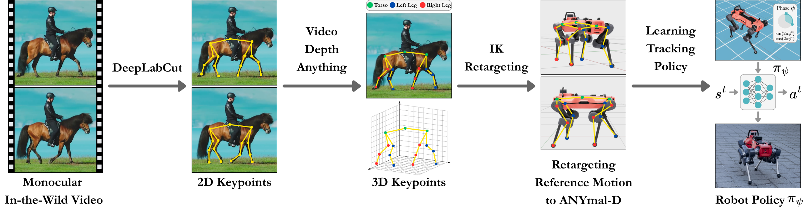

# 🐆 CopyQuad




**Learning quadrupedal locomotion from a single monocular, in-the-wild video. No motion capture, no per-gait reward engineering, no domain-specific 3D-pose network.**

```
 🎬 monocular video
      |  1-  DeepLabCut (SuperAnimal-Quadruped)            ->  2D keypoints
      |  2-  make_3d_csv.py                                ->  3D lift (no depth model)
      |  3-  preprocess_csv.py                             ->  cleaned reference skeleton
      |  4-  retarget.py (anisotropy-aware IK)             ->  ANYmal-D joint trajectory
      |  5-  recover_root_translation.py                   ->  global body motion restored
      |  6-  train_motion_imitation.py (phase DeepMimic)   ->  tracking policy
 🤖 ANYmal-D policy
```

Steps 1-2 live in **this** repository. Steps 3-6 live in the customized IsaacLab that ships as the `IsaacLab/` **submodule** ([modanesh/IsaacLab-IL](https://github.com/modanesh/IsaacLab-IL)).

---

## 📁 Repository layout

```
CopyQuad/
├── DLC/                         # 1- DeepLabCut 2D keypoint extraction
├── scripts/
│   ├── make_3d_csv.py           # 2- 2D -> 3D CSV lift (no depth model)
│   ├── unslowmo_video.py        #    clip conditioning: remove variable slow-motion (video)
│   ├── retime_npz_uniform.py    #    clip conditioning: remove gradual slow-motion (motion npz)
│   └── resample_ref_npz.py      #    clip conditioning: uniform time-resample a reference
├── checkpoints/                 # the 5 released policies (model.pt + train/eval config)
├── IsaacLab/                    # 🔗 submodule -> modanesh/IsaacLab-IL (steps 3-6 + assets)
│   └── scripts/
│       ├── retargeting/         # preprocess_csv.py, retarget.py, helpers.py, polish_motion.py,
│       │                        # synth_gesture.py
│       └── environments/        # train_motion_imitation.py, anymal_motion_playback.py,
│                                # data/recover_root_translation.py, data/motions/
└── data/                        # put your source clips here: data/videos/<clip>.mp4 (git-ignored)
```

The 5 trained policies ship in this repo under [`checkpoints/`](checkpoints), one per behavior, each with its `train_config.yaml` and `eval_config.yaml`. Each is the policy deployed on the physical ANYmal-D. Their reference motions live in the `IsaacLab-IL` submodule under `scripts/environments/data/motions/`.

---


<details>
<summary>
⚙️ Installation
</summary>

```bash
# 1. Clone with submodules (Isaac Lab)
git clone --recurse-submodules https://github.com/modanesh/CopyQuad.git
cd CopyQuad

# 2. Single virtual environment for the whole pipeline
python3.10 -m venv venv
source venv/bin/activate
pip install --upgrade pip setuptools wheel
```

Everything runs from **one** environment, and **the install order matters**: Isaac Lab
owns the `torch` / `numpy` versions, and the other two stages must be fitted around it.

**1. 🤖 Isaac Lab (with Isaac Sim)** -- install this *first*: it drives steps 4-6 and
playback, and it pins the deep-learning stack.

You need Isaac Sim 4.5. Either install it into the venv:
```bash
pip install "isaacsim[all,extscache]==4.5.0" --extra-index-url https://pypi.nvidia.com
```
or use an existing **binary** install and point the submodule at it:
```bash
ln -s /path/to/isaacsim IsaacLab/_isaac_sim
```

Then build Isaac Lab, and **repair the CUDA stack afterwards**:
```bash
cd IsaacLab && ./isaaclab.sh --install && cd ..

# --install pulls a cu130 torch on its way through, which leaves CUDA 13 libraries
# behind. Drop them, then reinstall the cu128 stack.
pip uninstall -y $(pip list --format=freeze | grep -i '^nvidia-' | grep -v -- '-cu12' | cut -d= -f1)
pip install --force-reinstall torch==2.7.0 torchvision==0.22.0 \
    --index-url https://download.pytorch.org/whl/cu128
pip install "numpy==1.26.4"   # the line above pulls numpy 2.x, which breaks `tables` in step 1

# Verify with a real convolution, not just cuda.is_available().
python -c "
import torch; x=torch.randn(1,3,64,64,device='cuda'); c=torch.nn.Conv2d(3,8,3).cuda()
print(torch.__version__, 'cudnn', torch.backends.cudnn.version(), c(x).shape)"
# expect: 2.7.0+cu128 cudnn 90701 torch.Size([1, 8, 62, 62])
```

> ⚠️ **Do not skip this**, and do not check it with `torch.cuda.is_available()` alone.
> `--install` briefly installs `torch 2.14.1+cu130`; re-pinning torch afterwards downgrades
> torch but leaves ~15 CUDA 13 `nvidia-*` wheels in place. On a CUDA 12 driver torch then
> loads the CUDA 13 cuDNN and **every convolution dies** with
> `cuDNN error: CUDNN_STATUS_NOT_INITIALIZED`, while `cuda.is_available()` still reports
> `True`. Step 1 (DeepLabCut) is what breaks; steps 4-6 keep working because Isaac Sim's
> bundled torch shadows the venv. If `torch.backends.cudnn.version()` reports anything other
> than `90701`, the purge above did not take.
>
> (An `egl_probe` build failure during `--install` is harmless; nothing here uses it.)

> ℹ️ Binary install only: run `source scripts/isaac_env.sh` once per shell, or everything
> below fails with `No module named 'isaacsim'`.

**2. 🐾 DeepLabCut 3.x** (step 1):
```bash
pip install -r DLC/requirements.txt
```
Its `torch` / `torchvision` requirements are unpinned, so they are satisfied by whatever
Isaac Lab installed and nothing is replaced.

**Verified environment.** The released results were produced with Python 3.10,
`torch 2.7.0+cu128`, `torchvision 0.22.0+cu128`, `numpy 1.26.4`, `isaaclab 0.54.3`,
`deeplabcut 3.0.0rc9`, `gymnasium 1.2.1`. Check yours with:
```bash
python -c "import torch, numpy; print(torch.__version__, numpy.__version__)"
```
</details>

---

## 🚀 Usage: from a video to a policy

Put your clip at `data/videos/<clip>.mp4` (create the directory if it is not there:
`mkdir -p data/videos`). The example below uses `horses_walk` (25 fps). Use the source frame
rate of your clip for `--fps`.

Step 1 processes **every** `.mp4` in `data/videos/` by default. To run a single clip, scope it:
```bash
export COPYQUAD_VIDEO=horses_walk     # a stem, or a full path
```

The five source clips behind the released motions ship in [`data/source_clips/`](data/source_clips) so the pipeline can be run end to end without sourcing your own footage. They were downloaded from YouTube and remain the property of their original creators; they are included for research reproducibility only.

### 1- 🐾 2D keypoints - DeepLabCut
```bash
python DLC/extract_2d_keypoints.py
# output -> data/2d_keypoints/<clip>_...csv
```

### 2- 📐 3D lift (no depth model)
```bash
python scripts/make_3d_csv.py horses_walk
# output -> data/3d_keypoints/horses_walk_with_depth_npz.csv
```
CopyQuad does not estimate depth. The retargeter reads an `(x, y, z)` triple per joint and
the lateral axis is pinned in step 4, so `z` is written as a constant and carries no
information. We verified this end to end: running the same clip through monocular depth
(Video-Depth-Anything) versus `z = 0` gives preprocessed references whose fore-aft and
vertical axes are **bit-identical**, and retargeted motions that agree to 5e-05 rad per
joint with identical root pose. The depth model changes only the axis that is thrown away.

### 3- 🧹 Preprocess - Reference skeleton
```bash
python IsaacLab/scripts/retargeting/preprocess_csv.py --csv data/3d_keypoints/horses_walk_with_depth_npz.csv --output IsaacLab/scripts/environments/data/motions/_refs/horses_walk_ref.npz --fps 25
```

### 4- 🦿 Retarget - ANYmal-D (anisotropy-aware IK)
```bash
cd IsaacLab
python scripts/retargeting/retarget.py --ref-motion scripts/environments/data/motions/_refs/horses_walk_ref.npz --output scripts/environments/data/motions/horses_walk.npz --fps 25 --lateral-mode pin
```

### 4b- 🙇 Gesture synthesis - bow and give-paw only
```bash
cd IsaacLab
# bow
python scripts/retargeting/synth_gesture.py --gesture bow \
  --input scripts/environments/data/motions/dog_bow_2_base.npz \
  --output scripts/environments/data/motions/dog_bow_2.npz
# give-paw
python scripts/retargeting/synth_gesture.py --gesture givepaw \
  --input <retargeted give-paw npz> \
  --output scripts/environments/data/motions/dog_givepaw_gentle.npz \
  --sched 20 25 20 25 20 --alpha-max 0.55 --brace 0.12
```
The two **gestures** need one pass the three gaits do not. Neither gesture clip contains a
clean single repetition: the bow is mostly a *held* pose with almost no transition, so a
policy trained on it just holds the extended pose, and the give-paw clip contains two
paw-lifts plus residual jitter in the raised leg.

This pass takes two **real retargeted poses** from the clip -- a neutral stand and the
extreme of the gesture -- and smoothstep-eases between them, producing one clean repetition
with zero velocity at every segment boundary and exact loop closure. The poses come from
the video; only the timing between them is synthesized. For the give-paw, `--alpha-max`
scales the whole gesture toward the stand pose (0.55 roughly halves the CoM excursion, which
is what makes it stable on hardware) and `--brace` splays the three stance legs outward as
the paw lifts.

### 5- 🧭 Recover global root translation
```bash
python IsaacLab/scripts/environments/data/recover_root_translation.py --motion IsaacLab/scripts/environments/data/motions/horses_walk.npz
```

>️ **Optional for clip conditioning.** Athletic or slow-motion source clips need extra steps before/after retargeting: `scripts/unslowmo_video.py` (variable slow-mo in the video), `scripts/retime_npz_uniform.py` (gradual slow-mo in the motion), `scripts/resample_ref_npz.py` (uniform speed-up), and `IsaacLab/scripts/retargeting/polish_motion.py` (joint-space smoothing + amplitude shaping to fit the robot's actuator limits, for athletic references).

### 6- 🎯 Train the tracking policy (phase-indexed DeepMimic)

```bash
cd IsaacLab
python scripts/environments/train_motion_imitation.py \
    --motion scripts/environments/data/motions/horses_walk.npz \
    --mode rl --phase-obs --num_envs 512 --rl_iters 4000 \
    --rl_root_w 0.1 --rl_action_rate_w 0.2 --rl_foot_z_weight 4.0 \
    --rl_sigma 0.5 --rl_foot_sigma 0.25 \
    --rl_dr --rl_dr_effort 0.75 1.0 \
    --save_dir ../checkpoints --headless
# -> ../checkpoints/horses_walk/policy_rl_<hash>/model.pt
```

<details>
<summary>
The reward weights are per-behavior.</summary>
The command above is the horse-walk recipe; the
other four differ, and using the wrong one will not reproduce the shipped policy. These are
the exact settings the released checkpoints were trained with, read back from each
`train_config.yaml`:

| flag | 🐕 dog walk | 🐴 horse walk | 🐴 horse trot | 🙇 dog bow | 🐾 give-paw |
|---|---|---|---|---|---|
| `--motion` | `dog1_slow` | `horses_walk` | `horses_trot_v2` | `dog_bow_2` | `dog_givepaw_gentle` |
| `--rl_iters` | 4000 | 4000 | 4000 | 3000 | 4000 |
| `--rl_root_w` | 0.2 | 0.1 | 0.1 | 0.1 | 0.2 |
| `--rl_action_rate_w` | 0.4 | 0.2 | 0.2 | 0.2 | 0.2 |
| `--rl_foot_z_weight` | 4.0 | 4.0 | 8.0 | 12.0 | 12.0 |
| `--rl_dr` | yes | yes | yes | no | yes |
| `--rl_dr_effort` | `0.65 1.0` | `0.75 1.0` | `0.75 1.0` | — | `0.65 1.0` |

`--rl_sigma 0.5` and `--rl_foot_sigma 0.25` are the same for all five and matter: at the
old code defaults (0.25 / 0.20) a seed-0 horse-trot run scored `e_q` 17.0 / `e_p` 17.8
against 12.2 / 14.4 for the shipped checkpoint, and collapsed late in training. They are
now the defaults, and shown above anyway.

Everything else is at its default (`--num_envs 512`, `--phase-obs`, `--rl_joint_w 0.5`,
`--rl_foot_w 0.3`, `--rl_root_sigma 0.25`, `--rl_lr 1e-4`, `--stiffness 200`, `--damping 5`).

> 🙇 **Give-paw peaks early.** Its return tops out near iter 1500 and then collapses to a
> dead policy by ~2100, so the last half of the run is wasted. `model.pt` is the best
> iterate, not the last, so the saved policy is unaffected.
</details>

**Evaluate** a trained policy:
```bash
python scripts/environments/train_motion_imitation.py --mode eval \
    --ckpt ../checkpoints/<clip>/policy_rl_<hash>/model.pt \
    --seed 0 --headless
```

---

## 🎥 Visualizing motions & policies

`anymal_motion_playback.py` renders a reference clip on ANYmal-D (needs a display):
```bash
cd IsaacLab
python scripts/environments/anymal_motion_playback.py --motion scripts/environments/data/motions/horses_trot_v2.npz
```
- 🟢 default: **kinematic** (base pinned, joints written directly, the retarget ground truth)
- 🔵 `--physics`: free base under gravity, joints as PD targets (dynamic feasibility check)
- 📸 `--hold-frame N`: freeze a single frame, feet grounded, for figures/screenshots

To record the trained policies instead of the references, `record_motions.sh` renders one
mp4 per behavior (robot-following camera, studio lighting, no debug overlays):
```bash
bash record_motions.sh              # all five
bash record_motions.sh dog_bow      # just one
```
It evaluates copies of the checkpoints in a scratch directory, so the released
`rollout.npz` / `eval_config.yaml` next to each policy are never overwritten.

---

## 🐕 Included behaviors

| Behavior | Reference motion | Policy | Kind |
|---|---|---|---|
| 🐕 Dog walk | `dog1_slow` | `policy_rl_8c5eb2` | 4-beat walk |
| 🐴 Horse walk | `horses_walk` | `policy_rl_ca7822` | 4-beat walk |
| 🐎 Horse trot | `horses_trot_v2` | `policy_rl_846766` | 2-beat diagonal trot |
| 🙇 Dog bow | `dog_bow_2` | `policy_rl_97e40f` | non-locomotion gesture |
| 🐾 Dog give-paw | `dog_givepaw_gentle` | `policy_rl_4f2367` | non-locomotion gesture |

These are the five behaviors reported in the paper. Each ships with its retargeted reference
motion and the policy deployed on the physical ANYmal-D, in the `IsaacLab-IL` submodule. The
two gestures additionally go through step 4b.

---

## 📝 Notes

- 📦 Large binaries (videos, most motion `.npz`, model checkpoints beyond the 5 released ones) are git-ignored. Regenerate them with the pipeline above.
- 🎬 The five source clips in `data/source_clips/` were downloaded from YouTube and belong to their original creators. Included for reproducibility only.

---

## 📄 License

MIT, see [LICENSE](LICENSE). The two submodules keep their own licenses: `IsaacLab/` is
BSD-3-Clause (a fork of NVIDIA Isaac Lab) and
repository.

---

## 📚 Citation

```bibtex
@article{danesh2026copyquad,
  title={CopyQuad: Quadrupedal Skill Transfer from a Single Side-View Video Without a Depth Model},
  author={Danesh, Mohamad H and Hu, Raina and Xu, Mengxue and Lin, Hsiu-Chin},
  journal={arXiv preprint arXiv:2610.16737},
  year={2026}
}
```
